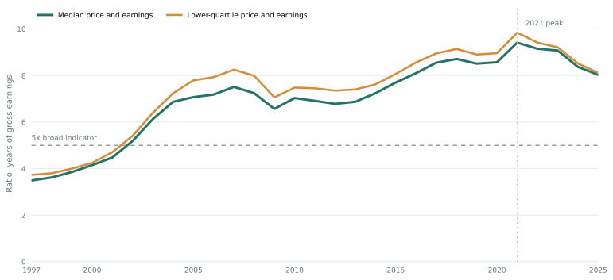
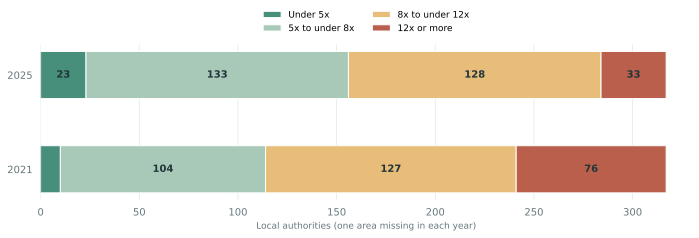
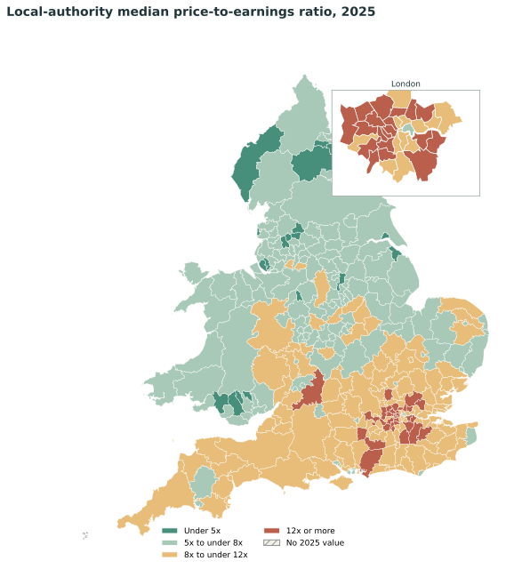
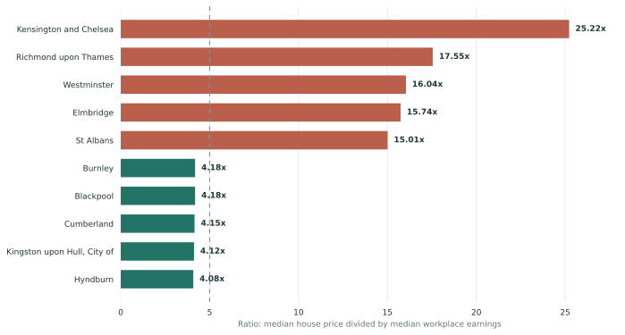

Housing affordability | England and Wales | 1997-2025

The ratio has fallen for four years. But a lower ratio is not the same as an affordable home: in 2025, **294 of 317 local authorities with data remained above the Office for National Statistics' broad five-times-earnings benchmark**.

::: {.metric-row}
::: {.metric-card}
8.03x
Median local-authority ratio in 2025
Down from 9.41x in 2021
:::

::: {.metric-card}
-15%
Change in the local-authority median since 2021
The ratio eased; the price-to-earnings gap remains
:::
::: {.metric-card}
103
Local authorities where the ratio rose in 2025
213 fell; 1 was unchanged; 1 had no 2025 value
:::
:::

## A four-year improvement, after a long rise

The median ratio across local authorities peaked in 2021. It has since fallen in both the median market and the lower-quartile measure. The lower-quartile series compares lower-quartile prices with lower-quartile earnings; it is a separate indicator of the entry-level market, not a measure of a particular first-time buyer's budget.

{fig-alt="Two local-authority median ratio series climb to a peak in 2021 then fall through 2025, remaining above five times earnings."}

**Read this as a direction-of-travel chart.** Each point is the median of local-authority ratios for that year, not the national England or Wales ratio. In 2025, the median was 8.03x for median prices and earnings, and 8.11x for lower-quartile prices and earnings.

## Explore a local authority

Choose an area to see its latest available median and lower-quartile ratios, and how both have changed since 1997. The dashed line marks the ONS five-times-earnings broad indicator. If an area's 2025 value is unavailable, the panel labels its latest available year.

  
Loading local-authority series...

## The distribution shifted, but most areas remain above five

The national five-times-earnings line is a broad affordability indicator. It does not account for deposits, mortgage costs, household income, or other costs of buying. Even using this broad threshold, 92.7% of local authorities with data were still above it in 2025.

{fig-alt="Stacked bars compare local authority counts in four ratio bands. Areas at twelve times earnings or more declined from 76 in 2021 to 33 in 2025; areas below five rose from 10 to 23."}

The number of areas at 12x or more fell from **76 in 2021 to 33 in 2025**. At the other end, the count below 5x rose from 10 to 23. Most areas, however, remained in the 5x to under 12x bands.

## The geography of the squeeze

The easing has not been evenly distributed. This map groups local authorities by their 2025 median price-to-workplace-earnings ratio; the London inset makes the smaller borough boundaries easier to compare. Isles of Scilly is shown as having no 2025 value.

{fig-alt="Map of England and Wales local authorities shaded by 2025 median price-to-earnings ratio: 23 below five, 133 from five to under eight, 128 from eight to under twelve, 33 at twelve or more, and one area with no 2025 value. London is enlarged in an inset."}

## A wide local gap

In 2025, the median-price ratio ranged from **4.08x in Hyndburn** to **25.22x in Kensington and Chelsea**. The highest ratio was more than six times the lowest. A national trend conceals very different local markets.

{fig-alt="Horizontal bars show Hyndburn at 4.08 times earnings at the low end and Kensington and Chelsea at 25.22 times at the high end, with three other local authorities at each end."}

### Lowest ratios in 2025

| Local authority | Ratio |
|:--|--:|
| Hyndburn | 4.08x |
| Kingston upon Hull | 4.12x |
| Cumberland | 4.15x |
| Blackpool | 4.18x |
| Burnley | 4.18x |

### Highest ratios in 2025

| Local authority | Ratio |
|:--|--:|
| Kensington and Chelsea | 25.22x |
| Richmond upon Thames | 17.55x |
| Westminster | 16.04x |
| Elmbridge | 15.74x |
| St Albans | 15.01x |

## What the national figures say

The ONS reported 2025 national median ratios of **7.6x in England** and **6.0x in Wales**. These national ratios are calculated from country-level house-price and earnings figures; they are not the median of the local-authority ratios shown in this report. The ONS reported that England's national ratio was its lowest since 2015, while Wales' returned to levels similar to 2015-2020. [ONS, *Housing affordability in England and Wales: 2025*](https://www.ons.gov.uk/peoplepopulationandcommunity/housing/bulletins/housingaffordabilityinenglandandwales/2025).

## How to interpret the ratio

The ratio divides house prices by gross annual earnings for full-time employees, using workplace-based earnings. It describes an individual earnings comparison, not household income. It does not account for two earners, self-employment, deposits, existing equity, mortgage rates, or ongoing housing costs. Homes sold are not mix-adjusted, so changes in the types of homes sold can affect the ratio.

The ONS uses five times earnings as a **broad indicator**, not a complete test of whether someone can buy a home. Its 2025 national calculation compares prices for homes sold in the year ending September 2025 with earnings around April 2025. Estimates for local areas also have sampling and comparability limitations.

## Data and method

This analysis uses the ONS **2025 House price to workplace-based earnings ratio** workbook, tables 5c (median prices and earnings) and 6c (lower-quartile prices and earnings), covering local authorities in England and Wales from 1997 to 2025. The 2025 median-price series has 317 available area values; Isles of Scilly is missing. The lower-quartile series also has 317 available values.

- [Download the ONS dataset](https://www.ons.gov.uk/peoplepopulationandcommunity/housing/datasets/ratioofhousepricetoworkplacebasedearningslowerquartileandmedian)
- [Read the ONS 2025 bulletin and methodology](https://www.ons.gov.uk/peoplepopulationandcommunity/housing/bulletins/housingaffordabilityinenglandandwales/2025)
- [View the analysis script and derived area data](https://github.com/aloysius109/housing-affordability-report)

The source workbook is included in this repository. Run `python scripts/analyze.py` to regenerate the charts and derived CSV files, then `quarto render` to rebuild the report. ONS data reused under the [Open Government Licence v3.0](https://www.nationalarchives.gov.uk/doc/open-government-licence/version/3/).

## Download the data

Download the area-level results, the annual trend series, or the source workbook used for this analysis.

::: {.download-list}
- [Local-authority ratios for 2025 (CSV)](data/derived/local_authority_ratios_2025.csv)
- [Annual local-authority medians, 1997–2025 (CSV)](data/derived/annual_local_authority_medians.csv)
- [Local-authority history for the explorer (JSON)](data/derived/local_authority_history.json)
- [ONS 2025 source workbook (Excel)](data/ons_housing_affordability_2025.xlsx)
:::

## Related reports

- [Where the UK plugs in](https://aloysius109.github.io/ev-charger-report/) — both reports compare local-authority patterns across England and Wales.
